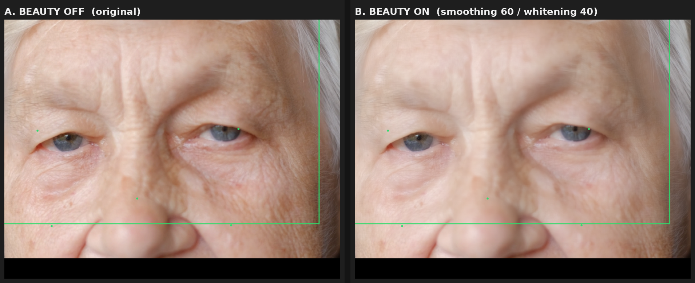

[简体中文](README_zh.md) | English

# Video Player with Automatic Face Beauty for Quectel Pi M2

A local video player demo for the [Quectel Pi M2](https://developer.quectel.com/doc/sbc/en/index.html): video is decoded on the VPU, faces are detected on the NPU, and smoothing/whitening is applied on the GPU only inside the face masks. It references [IINA](https://iina.io/) for desktop player interaction and [google/ExoPlayer](https://github.com/google/ExoPlayer) for the layered decode → filter → render design.


*The same player with M2 NPU face detection: boxes and five landmarks overlaid, info line shows `NPU: 2 face · 36.8 ms`.*


*The player on the board's DSI display (1280×800): 1080p30 decoded by `mppvideodec`, colour-converted on the GPU and rendered through an embedded `gtk4paintablesink`.*


*M3 split view (demo mode): the same frame with the original on the left and GPU smoothing + whitening on the right; the face mask comes from the NPU detection boxes.*



*M3 A/B close-up (detection on): left is the untouched frame, right has the GPU pass applied — wrinkles and redness are softened, the eyes stay sharp and hair/background outside the mask is untouched.*

> **Scope:** M1 playback, M2 NPU face detection and M3 GPU beauty/compare are implemented and verified on the board: hardware-decoded 1080p30 into an embedded GTK4 sink at a steady 30 fps, YuNet detection on the NPU (10 Hz, ≈30–40 ms per inference), and edge-preserving smoothing + whitening inside feathered face masks on the GPU (≈1 ms per frame). See [docs/PRD.md](docs/PRD.md) for the milestone plan.

## Features

Planned scope for the demo (P0 of the design note):

- **Hardware-decoded local playback** — MP4/MKV/MOV/TS files with H.264/H.265 decoded on the RK3576 VPU through GStreamer `mppvideodec`; AAC/MP3/Opus audio.
- **NPU face detection (implemented)** — a converted YuNet RKNN model runs on the NPU every Nth frame (10 Hz by default); boxes and five landmarks are drawn in GTK, and the info panel shows the face count and inference time. Nothing is processed when no face is present.
- **Automatic face beauty (implemented)** — one `glshader` pass smooths (edge-preserving 8-neighbour bilateral approximation) and whitens (with saturation compensation) only inside feathered, skin-gated face masks grown from the NPU boxes; nothing is processed when no face is present.
- **One-key before/after compare (implemented)** — the `B` key toggles the effect, `C` switches to a split-screen original/beautified view rendered in the same frame (adjustable split position); `--demo` forces the split view.
- **Player controls** — play/pause, seek, volume, fullscreen, 0.5×–2.0× speed, folder playlist and resume.
- **Info panel** — resolution, codec, hardware vs software decode, fps and NPU inference time.
- **In-app recording (implemented)** — `--record FILE` composes the GPU video branch with a UI overlay canvas inside `glvideomixer` and encodes it with `mpph264enc`, so a 30 fps MP4 with the full window (panels, face boxes, info line) can be produced on the board without a capture card; `--record-duration` stops automatically and `R` toggles it in the window.

> **Deferred for this phase:** network streams (HTTP/HLS/RTSP/RTMP, acceptance A6) and subtitles are out of scope per the 2026-11-14 scope decision. This phase focuses on local hardware-decoded playback, automatic beauty and the compare view.

P1 extensions, planned after the P0 acceptance:

| Extension | Description |
|-----------|-------------|
| Slim face | Landmark-driven GLES mesh warp for a narrower face |
| Enlarge eyes | The same landmark pipeline, applied to the eyes |
| Snapshot / export | Save a still frame, or re-encode a clip with hardware `mpph264enc` |
| UVC camera input | Deferred: the P2 decision keeps beauty on local video only, so camera preview is not in this phase |
| Web remote | A small FastAPI page for playback control over the network |

## Hardware Requirements

- Quectel Pi M2 board (RK3576, Debian 13 factory image)
- DSI display (1280×800) or an HDMI monitor, with touch or keyboard/mouse
- Speaker or headphones on the onboard ES8389 audio codec
- Test media: 1080p portrait footage in H.264/H.265 (company-owned or licensed); 4K footage is welcome as an optional demo, not an acceptance requirement
- No camera or network input is required for this phase (see the deferred scope above)

## Software Environment Setup

> `install.sh` validates the environment today. Package installation and the desktop entry are added in M4.

- OS: Debian 13 (Quectel Pi M2 factory image), GNOME/Wayland session
- Python: 3.10 or newer (3.13 on the board)
- Dependencies:
  - GStreamer 1.x with the Rockchip plugins (`mppvideodec`, `mpph264enc`) — from apt
  - `gst-plugin-gtk4` (`gtk4paintablesink`) — verified on the board image (0.13.5), used for GTK4 embedding
  - PyGObject and GTK4 — from apt, not pip
  - NumPy 2.2 — pinned in `requirements.txt`
  - RKNN runtime (`librknnrt.so`) and `librga.so` — provided by the board image
- Development only: `pytest>=8` from `requirements-dev.txt`

### Implementation Steps

1. Clone the project.

```bash
sudo apt update
sudo apt install -y git
git clone https://github.com/Trystwo/demo-video-player.git
```

The command creates a `demo-video-player` folder in the current directory.

2. Run the install script from the board terminal. It checks Python, GTK4, the GStreamer plugins, the RKNN libraries, the display session and the model directory.

```bash
cd demo-video-player
sudo chmod 755 install.sh
./install.sh
```

The script prints `Environment check complete`; the full deployment contract with `Deployment complete` arrives in M4. If a board item is missing, re-run with `--require-board` and compare the output with [docs/BOARD.md](docs/BOARD.md).

3. Verify the environment and run the tests.

```bash
PYTHONPATH=src python3 -m video_player --check
python3 scripts/probe_board.py --markdown
python3 -m pytest tests -q
```

The check ends with a summary such as `ok=9 warn=7 fail=0`; board-only items are reported as `warn` on a development host. The pytest run should report no failures (the NumPy mask tests are skipped where NumPy is not installed).

## Project Structure

```
demo-video-player/
├── configs/                    # tunable config: decode, beauty strengths, detection interval
├── docs/                       # PRD, architecture, board checklist, demo guide
│   ├── evidence/               # board screenshots used as acceptance evidence
│   └── images/                 # README screenshots
├── models/                     # RKNN face-detection models (see models/README.md; not committed)
├── scripts/                    # probe_board.py, launch_player.py, perf_probe.py
├── src/video_player/           # package: config, pipeline plan, beauty, face, envcheck
│   └── ui/                     # GTK4 window
├── tests/                      # pytest suite for config, beauty, face, pipeline, envcheck
├── install.sh                  # environment check / deployment script
├── requirements.txt            # Python dependency pins
├── README.md                   # English documentation
└── README_zh.md                # Chinese documentation
```

## Run the program

Start the scaffold window from the `src` directory:

```bash
cd demo-video-player/src
python3 -m video_player            # GTK4 window
python3 -m video_player /path/to/video.mp4   # play a file or a folder
python3 -m video_player --demo /path/to/video.mp4   # fullscreen demo mode
python3 -m video_player --check    # environment report only
python3 -m video_player --version
python3 -m video_player --demo /path/to/video.mp4 \
    --record /tmp/demo.mp4 --record-duration 10   # record the window (30 fps MP4)
```

The window opens on the board's display and plays local H.264/H.265/AAC media with hardware decoding, transport controls and a folder playlist. The beauty panel controls the GPU pass; the smoothing/whitening sliders apply to the running video as you drag them. Keys: `Space` play/pause, `B` beauty, `C` compare, `M` mask preview, `F` fullscreen, `R` start/stop recording. Recording re-encodes the window on the GPU and takes the GPU from the display sink (the on-screen video area goes black while recording, the file is fine); see [docs/ARCHITECTURE.md](docs/ARCHITECTURE.md) §2.3.

## Status

| Milestone | Scope | State |
|-----------|-------|-------|
| M0 | Project skeleton: config contract, pipeline plan, environment check, UI shell | ✅ 2026-11-14 |
| M1 | GStreamer hardware-decoded playback, GTK4 embedded sink, controls, playlist | ✅ 2026-11-14 (30 fps, CPU ≈16%) |
| M2 | RKNN YuNet face detection (10 Hz), GTK boxes/landmarks, NPU timing in the info panel | ✅ 2026-11-16 |
| M3 | GPU smoothing/whitening with face masks and compare mode | ✅ 2026-11-17 (30 fps, beauty ≈1 ms/frame, CPU 30–32% with detection off) |
| M4 | Acceptance A1–A5 (A6 deferred), board screenshots, demo video, full deployment script | ⏳ in progress (recording + demo video done; A4/A5 and `install.sh` open) |

## Related Projects

More board demos are available in the [Quectel-Pi](https://github.com/Quectel-Pi) organization:

- [demo-personal-cloudhost](https://github.com/Quectel-Pi/demo-personal-cloudhost): personal cloud host for the local network.
- [demo-gesture-remote-control](https://github.com/Quectel-Pi/demo-gesture-remote-control): gesture-based remote video control.
- [demo-webrtc-call](https://github.com/Quectel-Pi/demo-webrtc-call): two-way video calls between the board and a phone.
- [demo-rknn-object-detect](https://github.com/Quectel-Pi/demo-rknn-object-detect): real-time object detection and tracking.

## Documentation

- [Product requirements (PRD)](docs/PRD.md): positioning, P0/P1 features, acceptance criteria and milestones.
- [Architecture](docs/ARCHITECTURE.md): pipeline, zero-copy strategy, threading model and performance budget.
- [Board environment](docs/BOARD.md): board baseline, pending measurements, model and media checklist.
- [Demo guide](docs/DEMO_GUIDE.md): demo flow, talking points and fallback plans.
- [Design note](../../docs/43-视频播放器.md) (Chinese): original requirement, hardware analysis and open questions.
- [Chinese README](README_zh.md)

## Security and limitations

- Demo-level implementation, not a hardened distribution: there is no authentication, sandboxing or DRM.
- Video and image assets are not bundled. Provide your own, and only company-owned or licensed footage may be used in demos.
- RKNN model weights are not committed; follow [docs/BOARD.md](docs/BOARD.md) to convert and place them.
- M1 playback, M2 NPU detection and M3 GPU beauty work on the board: 30 fps with the shader on (detection off, CPU 30–32%), beauty ≈0.8–1.6 ms per frame. The full demo mode (detection + beauty + split view) also holds 30 fps but runs at 117–131% CPU, mostly the 10 Hz YuNet inference inherited from M2. A1 is measured for both H.264 and H.265 1080p30 (the H.265 pass uses the rotate-180 selfie clip, demo mode at a steady 30 fps); the 1 h soak test is still outstanding.
- Network streams are out of this phase; when re-enabled, they will be opened without validating remote content, so only connect to trusted sources.

## Reporting Issues
If you encounter any issues during use, please submit technical inquiries on the [Quectel Official Forum](https://forumschinese.quectel.com/c/quectel-pi/58). Our technical support team will respond promptly.
Issues and Pull Requests are welcome to help improve this project.
