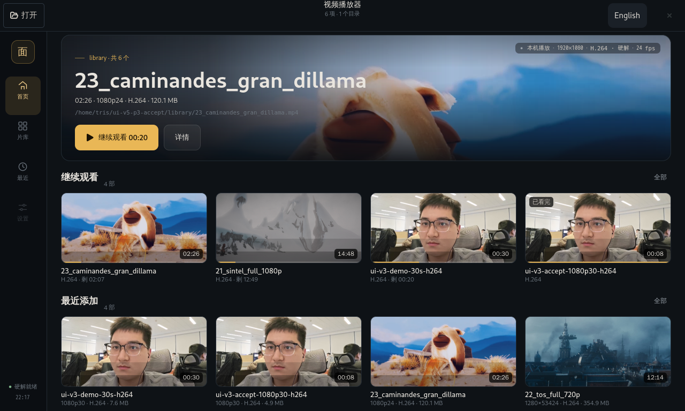

[简体中文](README_zh.md) | English

# Video Player for Quectel Pi M2

A local video player for the [Quectel Pi M2](https://developer.quectel.com/doc/sbc/en/index.html) (RK3576). Video is hard-decoded on the VPU and rendered in an embedded GTK4 surface, wrapped in a browse shell (home / library / recent / settings) and a picture-first player page with folder playlists, resume, sidecar subtitles, audio-track switching, speed, fullscreen and telemetry read from the running pipeline.

NPU face detection and GPU smoothing/whitening are optional abilities, off by default. `--demo` turns detection, beauty and the A|B split on together; the controls live in the player's 美颜 drawer.

| | |
|---|---|
| Board | Quectel Pi M2 (RK3576), Debian 13, DSI 1280×800 |
| Playback | 1080p30 H.264/H.265 hard-decoded, steady 30 fps |
| Detection | YuNet RKNN on the NPU, 10 Hz |
| Beauty | one GPU shader pass, ≈0.9 ms per 1080p frame |
| Tests | 49 pytest files (pure-Python, GTK and board-only) |
| Demo video | [Feishu](https://quectel.feishu.cn/wiki/DarawV37OiDQBQkPHAgct74KnGc) · [52 s MP4](https://github.com/Trystwo/demo-video-player/releases/download/v1.1.1/video-player-m5-demo-v3.mp4) |



*Board screenshot (1280×768, 2026-11-27): the home page — a continue-watching hero with a real CTA, history cards with progress hairlines and recently-added posters, all built from the scanned library and watch history.*

**Status.** The browse shell, player page, settings page and recent page are deployed and accepted on the board with the real VPU decoder and GPU beauty path. Touch taps, drag & drop, the folder picker, the sort popover and VP9/AV1/4K files are still unverified by hand — see [Limitations](#limitations).

## Features

### Player

- **Hardware-decoded local files** — MP4 / MOV / MKV / WebM / TS with H.264 and H.265 through `mppvideodec`; AAC / MP3 / Opus audio. VP9, AV1 and MPEG-2 have no VPU path and only play where a software decoder is installed. The transport bar switches between auto / forced hardware / forced software decode.
- **Transport** — play/pause, seek, volume, 0.5×–2.0× speed, fullscreen, previous/next, back; one 44 px row in every mode.
- **Player page** — the window keeps its real title bar (clip name, “＋ Open”, window buttons) and a 16:9 picture; the 360 px dock has 选集 and 美颜 tabs. One click on the picture toggles play/pause, a double click toggles fullscreen, and `Esc` unwinds drawer → panel → fullscreen → browse.
- **Empty state is a drop zone** — a plain launch lands on the home page; without a clip the player area becomes one drop zone with “Choose file” / “Choose folder” CTAs, and files or folders can be dropped straight onto it.
- **Subtitles and audio tracks** — a sidecar `.srt` (also `.zh.srt` / `.en.srt`, UTF-8 or GB18030) is drawn as a GTK layer above the picture; container audio tracks switch through the `CC` popover.
- **Chapters** — an optional `clip.mp4.chapters.json` sidecar draws real ticks on the timeline; a broken sidecar simply yields no marks.
- **Telemetry** — resolution / codec / decode path / measured fps / face and beauty state / process CPU, all read from the running pipeline.

### Browse shell

- **Left rail** — Home / Library / Recent / Settings, with decode readiness and the scan clock at the foot.
- **Library** — a 4-column poster grid over the scanned folders: background probe and poster cache, All / Finished filters, name / duration / recently-added sort, rescan, folder picker and an empty state. Drop a folder to scan it, drop a video to play it.
- **Home** — the most recently watched clip as a hero with a real “continue at mm:ss” CTA, four continue-watching cards and four recently-added cards.
- **Detail** — the clip's own frame as a backdrop, probe facts, a 3-column episode grid, “Continue at mm:ss” / “Replay” and the same-folder list. No invented ratings or synopses.
- **Recent** — watch history grouped into Continue watching / Finished, one tap to resume, a confirmed Clear history and an empty state.
- **Settings** — language (中文 / English), decode mode, scan folders, and an about card (version / platform / kernel / GTK / GStreamer / decode backend / state paths).

### Library and history

- **Folder playlist** — opening a file loads its folder (sorted by name); `P` / `N` and the arrows move through it.
- **Resume** — position per file in XDG state, keyed by path + size + mtime; restored after preroll, dropped in the first 10 s and the last 15 s. `player.resume: false` disables it.
- **Recently played** — up to 20 entries kept separately from resume positions, so a finished clip still shows up. `player.recent_files: false` disables it.
- **Library scan** — one level deep, de-duplicated across roots, capped at 500 files (`library.max_items`); folders picked in the UI persist in XDG state.
- **Chinese / English UI** — switch at runtime; `--lang {zh,en}` overrides it for one run. Chinese is the default.

### Board capabilities

- **NPU face detection** — a converted YuNet RKNN every 3rd frame (10 Hz) in a worker thread, with GTK corner brackets and a confidence tag; the landmarks drive the beauty warp. Off by default: the detector costs a one-off ~1.7 s NPU warm-up.
- **Detection hold** — a missing face keeps the last box for `detection.hold_ms` (600 ms), so beauty no longer flickers through detection gaps (measured 6 → 0 on close-ups).
- **GPU beauty** — one `glshader` pass smooths and whitens only inside feathered, skin-gated face ovals fitted to the landmarks; the CIELAB skin gate is what fixed white hair and flattened glasses.
- **Compare** — `C` or the A|B switch shows a same-frame split with labelled sides; `B` toggles the effect, `--demo` starts in split view.
- **Experimental warp** — face slim / eye enlarge sliders in the same shader; both default to 0 and add ≈0.1 ms per frame at 100.
- **In-app recording** — `R` or `--record FILE` composes the GPU branch with a UI overlay canvas in `glvideomixer` and encodes a 30 fps MP4 with `mpph264enc`, no capture card needed. The on-screen video area goes black while recording; the file itself is fine.

## How it is built

```
filesrc → qtdemux ─┬─ video ─ h26xparse → mppvideodec (VPU) → glupload → glcolorconvert
                   │          → glcolorscale (≤1280) → glshader (smooth + whiten + split + warp)
                   │          → tee ─┬→ fpsdisplaysink → gtk4paintablesink
                   │                └→ glvideomixer → mpph264enc   (--record)
                   └─ audio ─ decodebin → audioconvert → volume → autoaudiosink

decode src pad probe, every 3rd frame → worker thread → NV12→BGR → YuNet (NPU)
                                       → GLib.idle_add → shader uniforms
```

Two decisions carry most of the weight: the face oval, feather and skin gate are rasterised in the fragment shader from uniforms (no second mask texture, which `glshader` cannot bind), and `glcolorscale` pre-scales the texture because GSK otherwise falls back to CPU scaling and CPU jumps from 18% to 62–78%. The same-frame split keeps A|B free of pipeline alignment problems.

The interaction follows [IINA](https://iina.io/); the decode → filter → render split follows [ExoPlayer](https://github.com/google/ExoPlayer). See [docs/ARCHITECTURE.md](docs/ARCHITECTURE.md) for the full pipeline and threading model.

## Requirements and setup

- Quectel Pi M2 (RK3576), Debian 13, GNOME/Wayland, DSI panel 1280×800 (the window is designed for 1280×768)
- Python 3.10+ (the board ships 3.13), PyGObject + GTK 4 from **apt**, GStreamer 1.x with the Rockchip MPP plugins, `gst-plugin-gtk4`, NumPy 2.2, and the RKNN/RGA libraries
- Optional: `models/yunet_rk3576.rknn` for detection and beauty (see [models/README.md](models/README.md))
- No camera: detection and beauty run on the playing video
- Do not `pip install` PyGObject or the GStreamer bindings on the board — the typelibs must match the system GStreamer

```bash
git clone https://github.com/Trystwo/demo-video-player.git
cd demo-video-player
chmod 755 install.sh && ./install.sh --require-board   # launcher + desktop entry, no sudo/apt/network
video-player-demo --check                              # ends with ok= / warn= / fail=
```

`--require-board` turns the board-only checks into hard failures; a missing RKNN model only warns. `--venv DIR`, `--no-desktop`, `--bin-dir`, `--desktop-dir` and `--dry-run` adjust the install. On a GNOME session the script also installs the bundled Desktop Icons NG extension, which GNOME Shell only loads at login — **log out and back in once** after the first install.

A board without network or git can use the single-file offline installer: `bash board-install.sh [DEST]`. Its payload is generated — after changing any shipped file run `python3 scripts/build_board_install.py`.

## Run

```bash
video-player-demo                                               # home page
video-player-demo /path/to/video.mp4                            # windowed
video-player-demo --demo /path/to/folder                        # fullscreen demo mode
video-player-demo --lang en video.mp4                           # English UI for this run
video-player-demo --record /tmp/demo.mp4 --record-duration 10   # record the window
```

From the source tree, `cd src && python3 -m video_player ...` works the same. Other flags: `--fullscreen`, `--config FILE`, `--snapshot FILE`, `--snapshot-delay S`, `--check`, `--require-board`, `--version`.

| Key | Action | Key | Action |
|---|---|---|---|
| `Space` | play / pause | `S` | stop and rewind |
| `←` `→` | seek ∓10 s | `B` | beauty on / off |
| `P` `N` | previous / next | `C` | compare / split view |
| `F` | fullscreen (`Esc` exits) | `M` | mask preview |
| `O` | open file | `R` | start / stop recording |

One tap on the picture plays or pauses; a double tap toggles fullscreen.

## Configuration

Every tunable lives in one strictly validated JSON file — `configs/player.example.json` or whatever `--config` points at; unknown keys are an error and a bad value names the key. The common ones:

| Key | Default | What it does |
|---|---|---|
| `player.decode_mode` | `auto` | `auto` prefers the VPU and falls back to software; `hw` / `sw` force one path |
| `player.texture_max_dimension` | `1280` | pre-scale cap before the GTK sink |
| `player.volume` / `player.speed` | `80` / `1.0` | initial volume (0–100) and speed (0.5–2.0) |
| `player.resume` / `player.recent_files` | `true` / `true` | remember positions / keep the watch history |
| `detection.enabled` | `false` | NPU detection is opt-in (`--demo`, beauty or face boxes) |
| `detection.hold_ms` | `600` | how long a missing face keeps the last box (0–5000) |
| `beauty.enabled` | `false` | beauty stays off until `B` or the drawer switch |
| `beauty.smoothing` / `beauty.whitening` | `60` / `40` | strength 0–100, live while dragging |
| `beauty.face_slim` / `beauty.eye_enlarge` | `0` / `0` | experimental warp 0–100 |
| `library.directories` | `[]` | folders the library scans (one level deep) |
| `library.max_items` | `500` | cap for one scan |

## Performance

Measured on the board at 1080p30:

| Scenario | fps | CPU |
|---|---|---|
| Playback only | 30 | ≈16% |
| + beauty (detection off) | 30 | 30–32% |
| + detection + beauty | 30.0 | 117–131% |
| Full demo mode (split view, all on) | 30.8 | — |

The 10 Hz YuNet inference is the bulk of the detection cost; a one-hour soak completed (3,549 samples — see [docs/BOARD.md](docs/BOARD.md)).

## Testing

```bash
python3 -m pytest tests -q
PYTHONPATH=src python3 -m video_player --check
```

Cases that need PyGObject, GStreamer, NumPy or the RKNN runtime skip when those libraries are unavailable; board timings, real VPU decode and snapshot evidence still require the Pi M2.

## Documentation

[PRD](docs/PRD.md) · [Architecture](docs/ARCHITECTURE.md) · [Board notes](docs/BOARD.md) · [Pitfalls](docs/PITFALLS.md) · [Demo guide](docs/DEMO_GUIDE.md) · [Evidence](docs/evidence/README.md)

## Limitations

- Demo-level implementation, not a hardened distribution: no authentication, sandboxing or DRM. No network streams (HTTP/HLS/RTSP/RTMP), embedded subtitle tracks or `.ass` styling.
- Detection still samples on the streaming thread (`extract_dup()` of a full 1080p NV12 frame every 3rd frame, 17–33 ms) — that is why full demo mode runs above one core; RGA downscaling is the planned fix.
- Beauty is tuned for close-up portrait footage with up to three faces; 4K input is untested.
- **In-app recordings are tagged `yuvj420p` / `pc` / `gbr`.** The frames look correct, but a player or transcoder that strictly honours the tags may shift colours; two conversion attempts dropped the content to 5.5–6.9 unique frames/s and were reverted (see [docs/PITFALLS.md](docs/PITFALLS.md) §3).
- **Not verified by hand on the panel yet**: touch taps on chips/cards, real drag & drop, the folder picker, the sort popover, and H.265/VP9/AV1 files inside the browse shell.
- **The offline installer ships no RKNN model**, so `--check` reports one warning until `models/*.rknn` is copied in. Video and image assets are not bundled either.
- Performance numbers are board measurements, not guarantees for other content, codecs or display modes.

## License

Apache License 2.0 — see [LICENSE](LICENSE). Issues and pull requests are welcome; for technical support use the [Quectel forum](https://forumschinese.quectel.com/c/quectel-pi/58). More board demos: [Quectel-Pi](https://github.com/Quectel-Pi).
