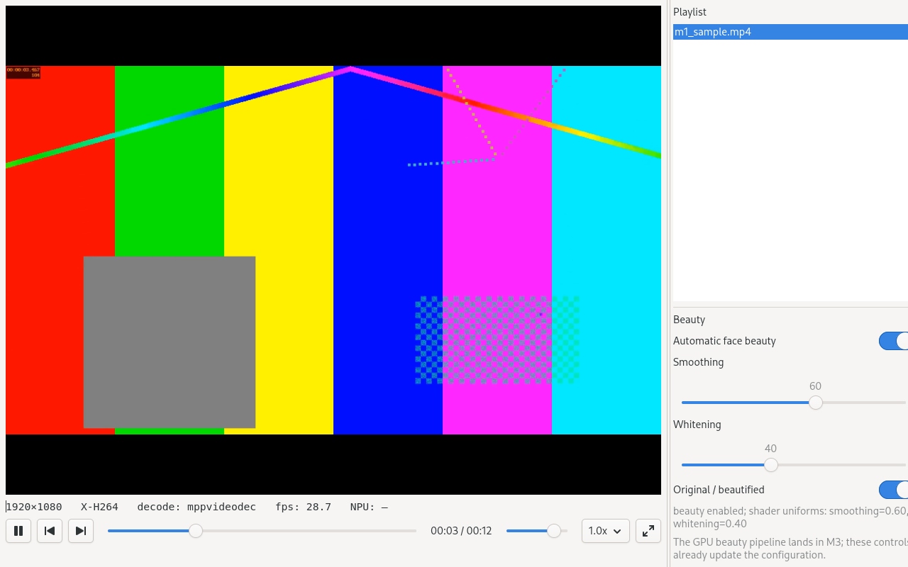
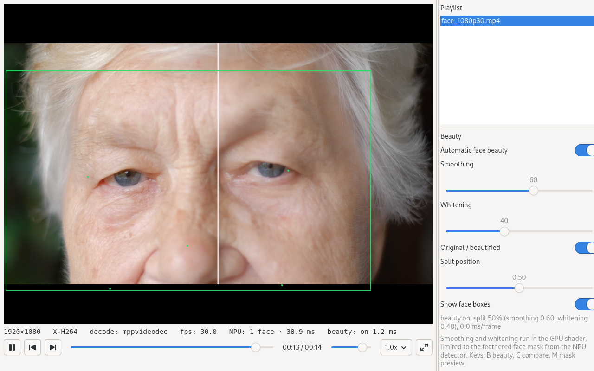

[简体中文](README_zh.md) | English

# Video Player for Quectel Pi M2

A local video player for the [Quectel Pi M2](https://developer.quectel.com/doc/sbc/en/index.html). MP4/MKV/MOV/TS files are decoded on the RK3576 VPU and rendered in an embedded GTK4 surface, with the things a player is actually judged on: a folder playlist with a recently-played history, resume, sidecar subtitles, audio-track switching, speed/fullscreen/volume control and an info panel that reports the real decode path and frame rate.

On top of playback it demonstrates two more blocks of the board: faces are detected on the NPU (YuNet RKNN) and smoothing/whitening run on the GPU inside a landmark-fitted face oval; M5 adds a detection hold (no flicker when detection misses a frame) plus experimental face slim / eye enlarge. Playback is the product, beauty is one ability of it. The interaction references [IINA](https://iina.io/) and the layered decode → filter → render design references [google/ExoPlayer](https://github.com/google/ExoPlayer).



*The same player with M2 NPU face detection: boxes and five landmarks overlaid, info line shows `NPU: 2 face · 36.8 ms`.*


*The player on the board's DSI display (1280×800): 1080p30 decoded by `mppvideodec`, colour-converted on the GPU and rendered through an embedded `gtk4paintablesink`.*



*M3 split view (demo mode): the same frame with the original on the left and GPU smoothing + whitening on the right; the face mask comes from the NPU detection boxes.*


*M3 A/B close-up (detection on): left is the untouched frame, right has the GPU pass applied — wrinkles and redness are softened, the eyes stay sharp and hair/background outside the mask is untouched.*

> **Scope:** M1 playback, M2 NPU face detection, M3 GPU beauty/compare, M4 acceptance and M5 detection hold plus experimental face slim / eye enlarge are implemented and verified on the board: hardware-decoded 1080p30 into an embedded GTK4 sink at a steady 30 fps, YuNet detection on the NPU (10 Hz, ≈30–40 ms per inference; no-face frames hold the last face/landmarks for `detection.hold_ms=600`, so the beauty pass no longer flickers), and edge-preserving smoothing + whitening inside feathered face masks on the GPU (≈0.87 ms per frame, +≈0.1 ms with the experimental warp at 100). See [docs/PRD.md](docs/PRD.md) for the milestone plan.

## Demo video

A 52 s v3 walk-through (1080p30, 35.5 MB, bilingual subtitles) was recorded on the board itself with the in-app recorder — no capture card:

- Feishu page (video embedded): [Video Player](https://quectel.feishu.cn/wiki/DarawV37OiDQBQkPHAgct74KnGc)
- GitHub release asset: [GitHub release](https://github.com/Trystwo/demo-video-player/releases/download/v1.1.0/video-player-m5-demo-v3.mp4)

It shows hardware-decoded 1080p30 playback of a single H.265 portrait clip: the untouched frame, the one-key beauty toggle (1.4× close-ups), the same-frame split view, a smoothing ramp 0→100, experimental face-slim and eye-enlarge ramps 0→100, every experimental effect on, and a before/after split. Detection hold keeps the face and landmarks through no-face frames, so the effect stays on without flicker.

## Features

Planned scope for the demo (P0 of the design note):

- **Hardware-decoded local playback** — MP4/MKV/MOV/TS files with H.264/H.265 decoded on the RK3576 VPU through GStreamer `mppvideodec`; AAC/MP3/Opus audio.
- **NPU face detection (implemented)** — a converted YuNet RKNN model runs on the NPU every Nth frame (10 Hz by default); boxes and five landmarks are drawn in GTK, and the info panel shows the face count and inference time. Nothing is processed when no face is present.
- **Detection hold (implemented, M5)** — when a frame has no detection, the last face box and five landmarks are kept for `detection.hold_ms` (600 ms by default, clamped to 0–5000); the beauty pass therefore stays on through transient detection gaps instead of switching off, which removes the periodic flicker seen in the M4 demo (measured on close-up footage: gaps 6 → 0). Set `detection.hold_ms: 0` for the old strict behaviour.
- **Automatic face beauty (implemented)** — one `glshader` pass smooths (edge-preserving 8-neighbour bilateral approximation) and whitens (with saturation compensation) only inside feathered, skin-gated face masks grown from the NPU boxes; nothing is processed when no face is present.
- **Experimental face slim / eye enlarge (implemented, experimental)** — a geometry inverse warp in the same shader. Face slim follows a five-landmark oval: the sides sample outward so the visible jaw narrows, and the area under the chin samples lower so the nearly-horizontal chin edge lifts instead of being pinned (peak `0.07×` the oval half-width, clamped to 4–30 px, 0.85 of that for the chin lift). The horizontal part depends on the oval-normalised x only, which removes the row-by-row collapse that read as a crease near the chin. A short smooth falloff just outside the silhouette lets the contour move without a hard seam: nearby edge pixels may shift slightly, while farther background remains unchanged. Eye enlarge keeps its in-face elliptical gate (`EYE_MAGNIFY=0.22`, radius `0.16×face width`, aspect `0.72`). Both sliders (`beauty.face_slim`, `beauty.eye_enlarge`, 0–100) default to 0, which is visually identical to M4, and add ≈0.1 ms/frame at 100. The first cut used local jaw-point displacement and a circular radial zoom (1.67×); it was reworked on 2026-11-19 after user feedback (dented cheek / unnatural eyes).
- **One-key before/after compare (implemented)** — the `B` key toggles the effect, `C` switches to a split-screen original/beautified view rendered in the same frame (adjustable split position); `--demo` forces the split view.
- **Player controls** — play/pause, seek, volume, fullscreen, 0.5×–2.0× speed and a folder playlist.
- **Resume (implemented)** — the position is stored per file (XDG state, keyed by path + size + mtime so a re-encoded clip starts over), restored after preroll and dropped in the first 10 s or the last 15 s; `player.resume: false` disables it.
- **Recently played (implemented)** — the sidebar lists the files opened last (up to 20, XDG state) with their watched/total time; one click reopens one. Finished clips stay in the history, rows whose file has vanished are hidden but the entries are kept, and `player.recent_files: false` turns it off.
- **Sidecar subtitles (implemented)** — a `.srt` next to the video is picked up automatically (`.zh.srt`/`.en.srt` variants included), drawn as a GTK layer above the picture so the 30 fps video path is untouched; the `CC` button toggles it and opens another file. UTF-8 and GB18030 are both decoded.
- **Audio-track switching (implemented)** — the container's audio pads are listed in the `CC` popover and switched through `qtdemux current-audio` plus a re-link and seek to the current position. Only the selected pad is linked, so dual-language files no longer play both tracks mixed together.
- **Chinese/English UI (implemented)** — the `English` / `中文` button at the right of the header switches every UI string at runtime (hints, errors, info line and the file dialog); the choice is saved to `~/.config/video-player-demo/ui.json` and reused on the next launch, while `--lang {zh,en}` overrides it for one run. Chinese is the default.
- **Info panel** — resolution, codec, hardware vs software decode, fps and NPU inference time.
- **In-app recording (implemented)** — `--record FILE` composes the GPU video branch with a UI overlay canvas inside `glvideomixer` and encodes it with `mpph264enc`, so a 30 fps MP4 with the full window (panels, face boxes, info line) can be produced on the board without a capture card; `--record-duration` stops automatically and `R` toggles it in the window.

> **Deferred for this phase:** network streams (HTTP/HLS/RTSP/RTMP, acceptance A6) and embedded subtitle/`.ass` styling. Sidecar `.srt` subtitles are in scope as of M6. This phase focuses on local hardware-decoded playback, automatic beauty and the compare view.

P1 extensions, planned after the P0 acceptance (slim face and enlarge eyes landed early as the experimental warp above; the rest remain P1):

| Extension | Description |
|-----------|-------------|
| Snapshot / export | Save a still frame, or re-encode a clip with hardware `mpph264enc` |
| UVC camera input | Deferred: the P2 decision keeps beauty on local video only, so camera preview is not in this phase |
| Web remote | A small FastAPI page for playback control over the network |

## Hardware Requirements

- Quectel Pi M2 board (RK3576, Debian 13 factory image)
- DSI display (1280×800) or an HDMI monitor, with touch or keyboard/mouse
- Speaker or headphones on the onboard ES8389 audio codec
- Test media: 1080p portrait footage in H.264/H.265 (company-owned or licensed); 4K footage is welcome as an optional demo, not an acceptance requirement
- No camera or network input is required for this phase (see the deferred scope above)

## Software Environment Setup

> `./install.sh` validates the environment and then deploys the player for the current user: a launcher on `PATH` and a desktop entry. No `sudo` and no `apt` are needed — the board image already ships the system packages.

- OS: Debian 13 (Quectel Pi M2 factory image), GNOME/Wayland session
- Python: 3.10 or newer (3.13 on the board)
- Dependencies:
  - GStreamer 1.x with the Rockchip plugins (`mppvideodec`, `mpph264enc`) — from apt
  - `gst-plugin-gtk4` (`gtk4paintablesink`) — verified on the board image (0.13.5), used for GTK4 embedding
  - PyGObject and GTK4 — from apt, not pip
  - NumPy 2.2 — pinned in `requirements.txt`
  - RKNN runtime (`librknnrt.so`) and `librga.so` — provided by the board image
- Development only: `pytest>=8` from `requirements-dev.txt`

### Implementation Steps

1. Clone the project.

```bash
sudo apt update
sudo apt install -y git
git clone https://github.com/Trystwo/demo-video-player.git
```

The command creates a `demo-video-player` folder in the current directory.

2. Run the install script from the board terminal. It checks Python, GTK4, the GStreamer plugins, the RKNN libraries, the display session and the model directory, then deploys the player for the current user.

```bash
cd demo-video-player
sudo chmod 755 install.sh
./install.sh --require-board
```

`--require-board` turns the board-only checks (mppvideodec, mpph264enc, waylandsink, gtk4paintablesink, librknnrt, librga) into hard failures. A missing `models/*.rknn` file only warns, because face detection is optional. On success the script prints `Deployment complete.` and the paths it wrote:

```text
  launcher:       ~/.local/bin/video-player-demo
  desktop entry:  ~/.local/share/applications/video-player-demo.desktop
```

Use `--no-desktop` to skip deployment, or `--desktop-dir DIR` / `--bin-dir DIR` to override the XDG directories.

3. Verify the environment and run the tests.

```bash
PYTHONPATH=src python3 -m video_player --check
python3 scripts/probe_board.py --markdown
python3 -m pytest tests -q
```

The check ends with a summary such as `ok=9 warn=7 fail=0`; board-only items are reported as `warn` on a development host. The pytest run should report no failures (the NumPy mask tests are skipped where NumPy is not installed).

## Project Structure

```
demo-video-player/
├── configs/                    # tunable config: decode, beauty strengths, detection interval
├── docs/                       # PRD, architecture, board checklist, demo guide
│   ├── evidence/               # board screenshots used as acceptance evidence
│   └── images/                 # README screenshots
├── models/                     # RKNN face-detection models (see models/README.md; not committed)
├── scripts/                    # probe_board.py, launch_player.py, perf_probe.py
├── src/video_player/           # package: config, pipeline plan, beauty, face, envcheck
│   └── ui/                     # GTK4 window
├── tests/                      # pytest suite for config, beauty, face, pipeline, envcheck
├── install.sh                  # environment check + deployment (launcher, desktop entry)
├── requirements.txt            # Python dependency pins
├── README.md                   # English documentation
└── README_zh.md                # Chinese documentation
```

## Run the program

Launch from the desktop menu ("Video Player" / "视频播放器") or from a terminal with the installed launcher:

```bash
video-player-demo /path/to/video.mp4          # windowed
video-player-demo --demo /path/to/media-folder  # fullscreen demo mode, folder playlist
```

Running from the source tree works the same way:

```bash
cd demo-video-player/src
python3 -m video_player            # GTK4 window
python3 -m video_player /path/to/video.mp4   # play a file or a folder
python3 -m video_player --demo /path/to/video.mp4   # fullscreen demo mode
python3 -m video_player --check    # environment report only
python3 -m video_player --version
python3 -m video_player --lang en video.mp4   # start with the English UI for this run
python3 -m video_player --demo /path/to/video.mp4 \
    --record /tmp/demo.mp4 --record-duration 10   # record the window (30 fps MP4)
```

The window opens on the board's display and plays local H.264/H.265/AAC media with hardware decoding, transport controls and a folder playlist. The beauty panel controls the GPU pass; the smoothing/whitening sliders apply to the running video as you drag them. The collapsible **Experimental** panel in the sidebar exposes the face-slim and eye-enlarge sliders (0–100, both default 0 so the look matches M4; the panel starts collapsed). Use the `English` / `中文` button at the right of the title bar to switch the UI language (Chinese by default); the choice is remembered. Keys: `Space` play/pause, `B` beauty, `C` compare, `M` mask preview, `F` fullscreen, `R` start/stop recording. Recording re-encodes the window on the GPU and takes the GPU from the display sink (the on-screen video area goes black while recording, the file is fine); see [docs/ARCHITECTURE.md](docs/ARCHITECTURE.md) §2.3.

## Status

| Milestone | Scope | State |
|-----------|-------|-------|
| M0 | Project skeleton: config contract, pipeline plan, environment check, UI shell | ✅ 2026-11-14 |
| M1 | GStreamer hardware-decoded playback, GTK4 embedded sink, controls, playlist | ✅ 2026-11-14 (30 fps, CPU ≈16%) |
| M2 | RKNN YuNet face detection (10 Hz), GTK boxes/landmarks, NPU timing in the info panel | ✅ 2026-11-16 |
| M3 | GPU smoothing/whitening with face masks and compare mode | ✅ 2026-11-17 (30 fps, beauty ≈1 ms/frame, CPU 30–32% with detection off) |
| M4 | Acceptance A1–A5 (A6 deferred), board screenshots, first demo video, full deployment script | ✅ done (2026-11-18): in-app recording, 61.8 s M3 demo video, `install.sh` launcher/desktop deployment, Feishu CN/EN pages, 1 h soak and three-face evidence; A1–A5 all met |
| M6 | Player capabilities: real resume, recently-played history, sidecar subtitles, audio-track switching, player-first layout | ✅ 2026-11-24 (board: resume 12.8 s restored, recently-played sidebar keeps its order across restarts and shows watched/total time, sidecar SRT on screen, 2 audio tracks switched with a seek back to position, 30.8 fps / beauty 2.4 ms with detection on) |
| M5 | Detection hold (anti-flicker), experimental face slim / eye enlarge, v3 demo video | ✅ 2026-11-18 (hold gaps 6 → 0 on close-ups; beauty + detection 30.0 fps, warp adds ≤0.1 ms/frame; 52.10 s / 1080p30 / 35.4 MB v3 video, 0 duplicate frames). 2026-11-19: warp geometry reworked (global lower-face narrowing + elliptical eye enlargement) after user feedback, experiment clips re-recorded, v3 rebuilt, released as v1.1.1 |

## Related Projects

More board demos are available in the [Quectel-Pi](https://github.com/Quectel-Pi) organization:

- [demo-personal-cloudhost](https://github.com/Quectel-Pi/demo-personal-cloudhost): personal cloud host for the local network.
- [demo-gesture-remote-control](https://github.com/Quectel-Pi/demo-gesture-remote-control): gesture-based remote video control.
- [demo-webrtc-call](https://github.com/Quectel-Pi/demo-webrtc-call): two-way video calls between the board and a phone.
- [demo-rknn-object-detect](https://github.com/Quectel-Pi/demo-rknn-object-detect): real-time object detection and tracking.

## Documentation

- [Product requirements (PRD)](docs/PRD.md): positioning, P0/P1 features, acceptance criteria and milestones.
- [Architecture](docs/ARCHITECTURE.md): pipeline, zero-copy strategy, threading model and performance budget.
- [Board environment](docs/BOARD.md): board baseline, pending measurements, model and media checklist.
- [Demo guide](docs/DEMO_GUIDE.md): demo flow, talking points and fallback plans.
- [Design note](../../docs/43-视频播放器.md) (Chinese): original requirement, hardware analysis and open questions.
- [Chinese README](README_zh.md)

## Security and limitations

- Demo-level implementation, not a hardened distribution: there is no authentication, sandboxing or DRM.
- Video and image assets are not bundled. Provide your own, and only company-owned or licensed footage may be used in demos.
- RKNN model weights are not committed; follow [docs/BOARD.md](docs/BOARD.md) to convert and place them.
- M1 playback, M2 NPU detection, M3 GPU beauty and M5 detection hold work on the board: 30 fps with the shader on (detection off, CPU 30–32%), beauty ≈0.86–0.87 ms per frame; with detection on, beauty + detection holds 30.0 fps, and the experimental warp adds ≤0.1 ms/frame at 100. The full demo mode (detection + beauty + split view) also holds 30 fps but runs at 117–131% CPU, mostly the 10 Hz YuNet inference inherited from M2. A1 is measured for both H.264 and H.265 1080p30 (the H.265 pass uses the rotate-180 selfie clip). The 1 h soak test completed (3,549 PERF samples; see [docs/BOARD.md](docs/BOARD.md)); A1–A5 are met, A6 deferred.
- Network streams are out of this phase; when re-enabled, they will be opened without validating remote content, so only connect to trusted sources.

## Reporting Issues
If you encounter any issues during use, please submit technical inquiries on the [Quectel Official Forum](https://forumschinese.quectel.com/c/quectel-pi/58). Our technical support team will respond promptly.
Issues and Pull Requests are welcome to help improve this project.
