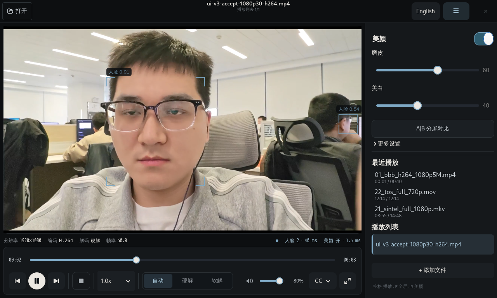

[简体中文](README_zh.md) | English

# Video Player for Quectel Pi M2

A local video player for the [Quectel Pi M2](https://developer.quectel.com/doc/sbc/en/index.html) (RK3576). Video is decoded on the VPU and rendered in an embedded GTK4 surface. The player carries what a player is actually judged on: folder playlist, recently-played history, resume, sidecar subtitles, audio-track switching, speed/fullscreen/volume, and an info panel that reports the real decode path and frame rate.

Face detection on the NPU and smoothing/whitening on the GPU sit on top of it as **one ability of the player** — a first-level Beauty panel at the top of the sidebar that can be switched off without touching playback. Both are off by default so a click starts playing immediately; `--demo` turns them on for the showcase.

| | |
|---|---|
| Board | Quectel Pi M2 (RK3576), Debian 13, DSI 1280×800 |
| Playback | 1080p30 H.264/H.265 hard-decoded, steady 30 fps |
| Detection | YuNet RKNN on the NPU, 10 Hz, ≈30–45 ms per inference |
| Beauty | one GPU shader pass, ≈0.9 ms per 1080p frame (≈2.4 ms with split view + warp) |
| Tests | 531 cases in 42 files |



*Board screenshot (2026-11-26, UI v3, 1280x768): the info row is labelled (resolution / codec / decode / frame rate) with a live face/beauty group on the right, codecs are normalised to `H.264`, the transport is back to 44 px keys in two rows, Beauty is a first-level sidebar panel, and face boxes are four-corner L brackets with a confidence tag. Empty state, fullscreen dock, fade-out telemetry and split captions are in [evidence](docs/evidence/README.md).*

## What it does

Grouped by what belongs to the player, what belongs to the library, and what the board adds on top of it.

**Playback**

- **Local playback, hardware decoded** — MP4 / M4V / MOV / MKV / WebM / TS / M2TS with H.264 and H.265 through `mppvideodec` on the VPU; AAC/MP3/Opus audio. Other codecs fall back to software decoders on a development host. A decode segment in the transport bar switches between **auto / forced hardware / forced software**; in auto the player drops to the CPU decoder by itself when the VPU path fails mid-clip.
- **Transport controls** — play/pause, seek, volume, 0.5×–2.0× speed, fullscreen, previous/next, return to playlist. The `A|B` compare toggle lives in the sidebar Beauty panel; fullscreen also gets a Compare pill in the dock.
- **Empty state is a drop zone** — the player page's no-clip state (a plain launch lands on the browse shell's home page instead) still accepts drops: with no clip open the transport disappears entirely and the picture area becomes one drop zone: a primary "Choose file" CTA, a secondary "Choose folder" CTA, a drag hint and capability chips. Files and folders can also be dropped straight onto the picture.
- **Browse shell** — launching without a file opens the shell: an 88 px rail (Home / Library / Recent / Settings), a poster grid built from real files (duration / resolution / codec probed in a worker thread, posters rendered from a background decode and cached), All / Recently watched / Finished filters, name / duration / recently-added sort, rescan, a folder picker and an empty state with scan-scope and format bars. Files and folders can be dropped anywhere: folders join the scan, videos play. `library.directories` seeds the scan; folders picked in the UI persist in XDG state. All three phases are deployed and accepted on the board.
- **Home page (ui-v5 P3)** — the landing page: a hero for the most recently watched clip (real "continue at mm:ss" CTA, probe facts, decode/track line, poster decoded at 1140 px), four Continue watching cards with progress hairlines and remaining time, and four Recently added cards. Every value comes from the scanned library and the play history; the hero is a flexible band, so an 1280×768 board window is never pushed past 768. An empty library gets the full first-run page (folder picker / open file / go to library) instead of an empty hero.
- **Detail page (ui-v5 P3)** — a card opens the clip's detail: a 1140 px backdrop from its own frame, folder / file-count / resolution / codec chips, "Continue at mm:ss" plus "Replay", a 3-column episode grid (files that share the folder; the current one is outlined, badged and scrolled into view), seven rows of probe facts (codec / picture / fps / duration / size / bitrate / decode) and a same-folder list. Nothing is invented: no rating, cast, VIP or synopsis — the mockup's blurb slot shows the real file path. The episode list is also the playlist, so previous / next / auto-advance stay inside it.
- **Fullscreen** — fullscreen drops the sidebar and turns the transport into an opaque dock with Beauty / Compare pills. After 2.5 s of stillness the dock fades, but the single-line telemetry in the top-left (resolution / codec / decode / fps / faces / beauty) and a 2 px progress hairline along the bottom stay visible; motion, a key press or a tap brings the dock back, and a paused frame keeps it up.
- **Sidecar subtitles** — a `.srt` next to the video loads automatically (`.zh.srt` / `.en.srt` variants too) and is drawn as a GTK layer above the picture, so the 30 fps video path is untouched. `CC` toggles it or opens another file; UTF-8 and GB18030 are both decoded.
- **Audio-track switching** — the container's audio pads are listed in the `CC` popover and switched through `qtdemux current-audio` plus a re-link and a seek back to the current position. Only the selected pad is linked, so dual-language files no longer play both tracks mixed.
- **Info row / telemetry** — windowed mode shows labelled resolution / codec / decode / frame-rate fields plus a live face/beauty group on the right; fullscreen shows the same data as one line in the top-left corner. Codec caps are normalised from `X-H264/X-H265` to `H.264/H.265`, all read from the running pipeline.

**Library**

- **Folder playlist** — opening a file loads its folder (sorted by name); arrows and keys move through it.
- **Resume** — position per file in XDG state, keyed by path + size + mtime so a re-encoded clip starts over; restored after preroll, dropped in the first 10 s and the last 15 s. `player.resume: false` disables it.
- **Recently played** — up to 20 entries, newest first, each showing watched/total time; one click reopens. Entries already in the current playlist are hidden (and the whole section hides when they all are), so no clip is listed twice. Finished clips stay; entries whose file has vanished are hidden but kept, so a reconnected drive brings them back. `player.recent_files: false` disables it.
- **Chinese/English UI** — switch at runtime from the header; the choice is saved, `--lang {zh,en}` overrides it for one run. Chinese is the default.

**Board capabilities**

- **NPU face detection** — a converted YuNet RKNN model runs every Nth frame (10 Hz by default) in a worker thread; four-corner L brackets and a confidence tag are drawn in GTK (the landmarks still drive the beauty warp but are no longer drawn as five dots). Nothing is processed when no face is present. Off by default: preparing the detector costs a one-off ~1.7 s NPU warm-up, so `B`, the sidebar switch or `--demo` opts in only when a face-driven effect is wanted.
- **Detection hold** — when a frame has no detection, the last box and landmarks are kept for `detection.hold_ms` (600 ms, clamped 0–5000), so the beauty pass stays on through detection gaps instead of flickering off (measured on close-ups: gaps 6 → 0).
- **Automatic beauty** — one `glshader` pass smooths (edge-preserving bilateral approximation) and whitens (with saturation compensation) only inside feathered, skin-gated face ovals fitted to the landmarks. The skin gate uses two CIELAB thresholds, which is what fixed "hair turns white, glasses frame gets flattened".
- **Compare** — the `A|B` button in the Beauty panel, the Compare pill in the fullscreen dock, or `C` switches to a same-frame split with the original on the left; labels on both sides of the divider name original/beautified and show the active smoothing/whitening values. `B` toggles the effect. `--demo` starts in split view, opens the Beauty panel and turns beauty on explicitly (it is off by default).
- **Experimental face slim / eye enlarge** — geometry inverse warp in the same shader; both sliders default to 0 (visually identical to no warp) and add ≈0.1 ms per frame at 100.


*Demo-mode split view on the board, at smoothing 100 / whitening 100 with the divider at 0.50: the left half is untouched, the right is the GPU pass inside the landmark-fitted face oval. At the default 60 / 40 the difference is deliberately milder.*

## How it is built

```
filesrc → qtdemux ─┬─ video ─ h26xparse → mppvideodec (VPU) → glupload → glcolorconvert
                   │          → glcolorscale (≤1280) → glshader (smooth + whiten + split + warp)
                   │          → tee ─┬→ fpsdisplaysink → gtk4paintablesink
                   │                └→ glvideomixer → mpph264enc   (--record)
                   └─ audio ─ decodebin → audioconvert → volume → autoaudiosink

decode src pad probe, every 3rd frame → worker thread → NV12→BGR → YuNet (NPU)
                                       → GLib.idle_add → shader uniforms
```

Three details that matter more than they look:

- **No second mask texture.** Face oval, feather and skin gate are rasterised in the fragment shader from float uniforms, which sidesteps the single-sampler limit of `glshader`.
- **Same-frame split.** `u_compare` slices left/right inside the fragment shader, so there is no two-pipeline frame-alignment problem.
- **Pre-scaling before the sink.** When the texture is smaller than half the widget, GSK falls back to CPU scaling and CPU jumps from 18% to 62–78%; `glcolorscale` avoids it. Keep `player.texture_max_dimension` in mind when you change the layout.

Interaction follows [IINA](https://iina.io/); the decode → filter → render split follows [ExoPlayer](https://github.com/google/ExoPlayer). See [docs/ARCHITECTURE.md](docs/ARCHITECTURE.md) for the full pipeline and threading model, and [docs/PITFALLS.md](docs/PITFALLS.md) for the traps that cost real time.

## Install

`./install.sh` checks the environment and deploys the player for the current user — a launcher on `PATH` and a desktop entry. No `sudo`, no `apt`: the board image already ships the system packages.

```bash
git clone https://github.com/Trystwo/demo-video-player.git
cd demo-video-player
chmod 755 install.sh
./install.sh --require-board
```

`--require-board` turns the board-only checks (`mppvideodec`, `mpph264enc`, `gtk4paintablesink`, `librknnrt`, `librga`) into hard failures; a missing `models/*.rknn` only warns, because detection is optional. Use `--no-desktop` to skip deployment, or `--bin-dir` / `--desktop-dir` to override the XDG targets.

`install.sh` also gives the app a dedicated icon (SVG plus 48/64/128/256 PNG), a `~/Desktop` shortcut and a GNOME Dash favourite. On a GNOME session it additionally installs the bundled **Desktop Icons NG (DING)** extension user-level — `~/.local/share/gnome-shell/extensions/ding@rastersoft.com/` plus its GSettings schema; GPL-3.0, provenance in `assets/desktop-icons/NOTICE.md` — so icons actually show up on the desktop. Still no `sudo`, no `apt`, no network. GNOME Shell scans extension directories only at startup, so **log out and back in once** (or reboot) after the first install; every later login loads it automatically.

For a board without network or git access, `board-install.sh` is a single-file offline installer: sources, icon and the desktop-icons extension are embedded, so `bash board-install.sh [DEST]` on the board is enough. The embedded payload is generated — after changing any shipped file run `python3 scripts/build_board_install.py` (and `--check` in CI/release), otherwise the offline installer keeps shipping the old UI.

Requirements: Debian 13 (factory image) on a GNOME/Wayland session, Python 3.10+ (3.13 on the board), GStreamer 1.x with the Rockchip plugins, `gst-plugin-gtk4` (0.13.5 on the image), PyGObject + GTK4 from **apt** (never pip — the typelibs must match the system GStreamer), NumPy 2.2, and the RKNN/RGA libraries from the board packages.

Verify before running:

```bash
PYTHONPATH=src python3 -m video_player --check     # ends with ok=/warn=/fail=
python3 scripts/probe_board.py --markdown          # board capability report
python3 -m pytest tests -q                         # 531 cases; NumPy/GI ones skip off-board
```

## Run

```bash
video-player-demo                                               # opens the library page
video-player-demo /path/to/video.mp4                            # windowed
video-player-demo --demo /path/to/folder                        # fullscreen demo mode
video-player-demo --lang en video.mp4                           # English UI for this run
video-player-demo --record /tmp/demo.mp4 --record-duration 10   # record the window
```

From the source tree, `cd src && python3 -m video_player ...` works the same way. Other flags: `--fullscreen`, `--config FILE`, `--snapshot FILE`, `--snapshot-delay S`, `--version`.

`--record` composes the GPU branch with a UI overlay canvas inside `glvideomixer` and encodes with `mpph264enc`, so a 30 fps MP4 of the whole window — panels, boxes, info line — can be produced on the board without a capture card. While recording, the on-screen video area goes black because the GPU branch feeds the encoder; the file itself is fine.

### Keys

| Key | Action | Key | Action |
|---|---|---|---|
| `Space` | play / pause | `S` | stop and rewind |
| `←` `→` | seek ∓10 s | `B` | beauty on / off |
| `P` `N` | previous / next | `C` | compare / split view |
| `F` | fullscreen HUD (`Esc` exits) | `M` | mask preview |
| `O` | open file | `R` | start / stop recording |

## Configuration

Every tunable lives in one JSON file — `configs/player.example.json`, or whatever `--config` points at. It is validated strictly: unknown keys are an error, out-of-range numbers are clamped, and a bad value names the key.

| Key | Default | What it does |
|---|---|---|
| `player.decode_mode` | `auto` | decode strategy: `auto` prefers the VPU and falls back to software; `hw` / `sw` force one path |
| `player.resume` | `true` | remember the position per file |
| `player.recent_files` | `true` | keep the recently-played history |
| `player.texture_max_dimension` | `1280` | pre-scale cap before the GTK sink (see the CPU note above) |
| `detection.enabled` | `false` | NPU face detection off by default (a click starts playing at once); `--demo` / beauty / face boxes opt in; a custom `--config` with `true` always wins |
| `detection.hold_ms` | `600` | how long a missing face keeps the last box (0–5000) |
| `detection.max_faces` | `3` | faces tracked per frame |
| `beauty.enabled` | `false` | the beauty pass is off by default; `B` or the sidebar switch turns it on; `--demo` starts with it on |
| `beauty.smoothing` / `beauty.whitening` | `60` / `40` | strength 0–100, live while dragging |
| `beauty.face_slim` / `beauty.eye_enlarge` | `0` / `0` | experimental warp 0–100 |
| `library.directories` | `[]` | folders the library page scans (one level deep). Empty means the empty state; folders chosen in the UI are appended from XDG state at launch. `library.max_items` caps one scan (default 500) |

## Project layout

```
demo-video-player/
├── configs/player.example.json   # the only source of truth for tunables
├── docs/                         # PRD, architecture, board notes, pitfalls, evidence
├── models/                       # YuNet RKNN weights (see models/README.md; not committed)
├── scripts/                      # probe_board, perf_probe, model conversion, offline-installer build
├── src/video_player/
│   ├── app.py                    # CLI entry point
│   ├── backend.py                # GStreamer pipeline: build, probe, seek, record
│   ├── pipeline.py               # element selection per container/codec (pure, testable)
│   ├── playlist.py               # folder scanning
│   ├── library.py                # library folders, scan, metadata cache, filters
│   ├── probe.py                  # metadata and poster probing on worker threads
│   ├── resume.py                 # per-file position store
│   ├── recents.py                # recently-played store
│   ├── subtitle.py               # SRT parsing and candidate search
│   ├── beauty.py                 # GLSL shader and uniforms
│   ├── detection.py              # frame sampling, hold, landmark EMA
│   ├── face.py / face_yunet.py   # geometry and model wrapper
│   ├── rknn_runtime.py           # NPU runtime binding, with a no-NPU fallback
│   ├── recording.py              # in-app recorder
│   ├── config.py / envcheck.py / i18n.py / diagnostics.py
│   └── ui/                       # GTK4 window, style tokens, library page, recorder overlay
├── tests/                        # 531 pytest cases
├── install.sh                    # environment check + user-level deployment
└── board-install.sh              # single-file offline installer (embedded source payload)
```

## Performance

Measured on the board at 1080p30:

| Scenario | fps | CPU | Notes |
|---|---|---|---|
| Playback only | 30 | ≈16% | M1 baseline |
| + beauty (detection off) | 30 | 30–32% | 0.87 ms per frame for the shader |
| + detection + beauty | 30.0 | 117–131% | the 10 Hz YuNet inference is the bulk |
| + experimental warp at 100 | 30 | +≈0.1 ms/frame | |
| Full demo mode (split view, all on) | 30.8 | — | beauty 2.4 ms, NPU 45 ms |

A one-hour soak completed (3,549 samples — see [docs/BOARD.md](docs/BOARD.md)).

## Status

| Milestone | Scope | State |
|---|---|---|
| M0 | Skeleton: config contract, pipeline plan, environment check, UI shell | ✅ 2026-11-14 |
| M1 | Hardware-decoded playback, GTK4 sink, controls, playlist | ✅ 2026-11-14 (30 fps, CPU ≈16%) |
| M2 | YuNet detection at 10 Hz, boxes/landmarks, NPU timing in the info panel | ✅ 2026-11-16 |
| M3 | GPU smoothing/whitening with face masks, compare view | ✅ 2026-11-17 (beauty ≈1 ms/frame) |
| M4 | Acceptance A1–A5, board evidence, first demo video, deployment script | ✅ 2026-11-18 |
| M5 | Detection hold, experimental face slim / eye enlarge, v3 demo video | ✅ 2026-11-19 (v1.1.1; hold gaps 6 → 0) |
| M6 | Player capabilities: real resume, recently played, sidecar subtitles, audio-track switching, player-first layout | ✅ 2026-11-24 (board: resume 12.8 s restored, history keeps its order across restarts, SRT on screen, 2 tracks switched with a seek back, 30.8 fps / beauty 2.4 ms) |
| UI v5 | Browse shell: amber token theme (P1), left rail + library grid + filters/sort + empty state + drag & drop (P2), home + detail pages (P3) | ✅ 2026-11-27 (v1.2.0): P1/P2 board-accepted 2026-11-26; P3 deployed and accepted with home / detail / resume seek / EOS auto-advance; in-app recording now includes the header bar |

Network streams (HTTP/HLS/RTSP/RTMP, acceptance A6) and embedded subtitle tracks / `.ass` styling stay out of scope.

## Demo video

A 52 s walk-through (1080p30, bilingual subtitles) was recorded on the board with the in-app recorder — no capture card: [Feishu page](https://quectel.feishu.cn/wiki/DarawV37OiDQBQkPHAgct74KnGc) · [GitHub release asset](https://github.com/Trystwo/demo-video-player/releases/download/v1.1.1/video-player-m5-demo-v3.mp4).

## Limitations

- Demo-level implementation, not a hardened distribution: no authentication, sandboxing or DRM.
- Local files only. When network streams are re-enabled they will be opened without validating remote content — only connect to trusted sources.
- Detection still samples on the streaming thread (`extract_dup()` of a full 1080p NV12 frame every 3rd frame, 17–33 ms). That is the known reason full demo mode runs above one core; moving it to RGA downscaling is the planned fix.
- Beauty is tuned for close-up portrait footage with up to three faces (`detection.max_faces`); 4K input is untested, and very poor footage can still leave gaps longer than `detection.hold_ms`.
- **In-app recordings are tagged `yuvj420p` / `pc` / `gbr`**, because the RGBA (sRGB) canvas is fed straight to `mpph264enc`. The frames look correct, but a player or transcoder that strictly honours the tags may shift colours. Two attempts to convert the branch to `yuv420p` / `tv` / `bt709` dropped the content to 5.5–6.9 unique frames/s (and the CPU variant lost the moov atom), so they were reverted; see [docs/PITFALLS.md](docs/PITFALLS.md) §3.
- **Not verified by hand on the panel yet**: touch taps on chips/cards, real drag & drop, the folder picker, the sort popover, and H.265/VP9/AV1 files inside the browse shell. Verification used synthetic events and H.264/H.265 acceptance clips.
- **The offline installer ships no RKNN model**: `bash board-install.sh` lays down the sources but `models/*.rknn` is absent (licence/size), so `--check` reports one warning until the model is copied in.
- Video and image assets are not bundled, and RKNN weights are not committed — see [docs/BOARD.md](docs/BOARD.md) to convert and place the model. Only company-owned or licensed footage may be used in demos.

## Documentation

- [Product requirements](docs/PRD.md) — positioning, P0/P1 features, acceptance criteria, milestones.
- [Architecture](docs/ARCHITECTURE.md) — pipeline, zero-copy strategy, threading, performance budget.
- [Board notes](docs/BOARD.md) — baseline, measurements, model and media checklist.
- [Pitfalls](docs/PITFALLS.md) — the traps that cost real time on this board.
- [Demo guide](docs/DEMO_GUIDE.md) — demo flow, talking points, fallback plans.

## Related projects

More board demos from the [Quectel-Pi](https://github.com/Quectel-Pi) organization:

- [demo-personal-cloudhost](https://github.com/Quectel-Pi/demo-personal-cloudhost) — personal cloud host for the local network.
- [demo-gesture-remote-control](https://github.com/Quectel-Pi/demo-gesture-remote-control) — gesture-based remote video control.
- [demo-webrtc-call](https://github.com/Quectel-Pi/demo-webrtc-call) — two-way video calls between the board and a phone.
- [demo-rknn-object-detect](https://github.com/Quectel-Pi/demo-rknn-object-detect) — real-time object detection and tracking.

## Reporting issues

Licensed under the Apache License 2.0 — see [LICENSE](LICENSE).

Issues and pull requests are welcome. For technical inquiries about the board, use the [Quectel forum](https://forumschinese.quectel.com/c/quectel-pi/58).
