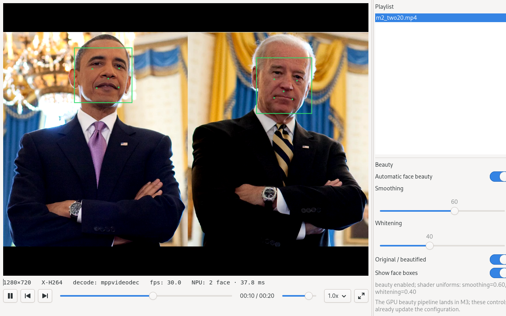

[English](README.md) | 简体中文

# Quectel Pi M2 视频播放器（自动美颜）

面向 [Quectel Pi M2](https://developer.quectel.com/doc/sbc/en/index.html) 的本地视频播放器 Demo：视频由 VPU 硬解，人脸由 NPU 检测，磨皮与美白由 GPU 只在人脸遮罩内完成。桌面交互参考 [IINA](https://iina.io/)，分层设计（解码 → 滤镜 → 渲染）参考 [google/ExoPlayer](https://github.com/google/ExoPlayer)。


*M2 NPU 人脸检测：叠加人脸框与 5 个关键点，信息行显示 `NPU: 2 face · 36.8 ms`。*



*板端 DSI 屏（1280×800）上的播放器：1080p30 由 `mppvideodec` 硬解、GPU 做色彩转换、内嵌 `gtk4paintablesink` 渲染。*


*M3 分屏对比（demo 模式）：同一帧左侧原图、右侧 GPU 磨皮 + 美白；人脸遮罩来自 NPU 检测框。*


*M3 近景 A/B 对比（检测开启）：左侧未处理、右侧经 GPU 美颜——皱纹与泛红被平滑，眼睛保持锐利，遮罩外的头发与背景不受影响。*

> **范围说明：** M1 播放、M2 NPU 人脸检测与 M3 GPU 美颜/对比均已在板端验证：1080p30 硬解 + GTK4 内嵌稳定 30fps；YuNet 模型在 NPU 上以 10Hz 采样（单次约 30–40ms）；磨皮与美白在 GPU 的单个 `glshader` 里完成，只在由检测框生成的羽化人脸遮罩内生效（单帧约 1ms）。里程碑见 [docs/PRD.md](docs/PRD.md)。

## 功能特性

Demo 规划范围（设计文档的 P0）：

- **本地文件硬解播放** —— MP4/MKV/MOV/TS，H.264/H.265 经 RK3576 VPU 由 GStreamer `mppvideodec` 硬解；音频支持 AAC/MP3/Opus。
- **NPU 人脸检测（已实现）** —— YuNet RKNN 模型每隔 N 帧（默认 10Hz）在 NPU 上运行，GTK 图层绘制人脸框与 5 个关键点，信息面板显示人脸数与推理耗时；画面无人脸时不处理。
- **自动美颜（已实现）** —— 单个 `glshader` pass：保边双边近似磨皮 + 带饱和度回补的美白，只作用在由 NPU 人脸框外扩、羽化并经肤色门限保护的人脸遮罩内；无人脸时整条链路透传。
- **一键对比（已实现）** —— `B` 键开关美颜，`C` 键切换同帧分屏对比（分割位置可拖动），`--demo` 模式强制分屏。
- **播放控制** —— 播放/暂停、拖动进度、音量、全屏、0.5×–2.0× 倍速、文件夹播放列表与断点续播。
- **信息面板** —— 显示分辨率、编码格式、硬解/软解、实际帧率与 NPU 推理耗时。

> **本期不做：** 按 2026-11-14 范围决策，网络流（HTTP/HLS/RTSP/RTMP，验收 A6）与字幕移出本期；本期聚焦本地硬解播放、自动美颜与对比视图。

P1 增强项，在 P0 验收后安排：

| 增强项 | 说明 |
|--------|------|
| 瘦脸 | 基于关键点的 GLES 网格变形，让脸更窄 |
| 大眼 | 同一套关键点管线，只作用于眼睛 |
| 截图/导出 | 保存单帧，或用硬编 `mpph264enc` 重新编码片段 |
| UVC 摄像头输入 | 本期不做：P2 结论为美颜仅作用于本地视频，摄像头实时预览推迟到后续版本 |
| Web 遥控 | 一个小的 FastAPI 页面，通过网络控制播放 |

## 硬件要求

- Quectel Pi M2 开发板（RK3576，Debian 13 出厂镜像）
- DSI 屏（1280×800）或 HDMI 显示器，配触摸屏或键鼠
- 板载 ES8389 声卡接扬声器或耳机
- 测试视频：1080p 人像素材，H.264/H.265 编码（公司自有或已授权）；4K 素材可作为可选演示，不作验收要求
- 本期不需要摄像头或网络输入（见上方“本期不做”）

## 软件环境搭建

> `install.sh` 目前做环境校验。软件包安装与桌面入口在 M4 补齐。

- 操作系统：Debian 13（Quectel Pi M2 出厂镜像），GNOME/Wayland 会话
- Python：3.10 或更高版本（板端为 3.13）
- 依赖：
  - GStreamer 1.x 及 Rockchip 插件（`mppvideodec`、`mpph264enc`）—— 来自 apt
  - `gst-plugin-gtk4`（`gtk4paintablesink`）—— 板端镜像已带（0.13.5），用于 GTK4 内嵌
  - PyGObject 与 GTK4 —— 来自 apt，不走 pip
  - NumPy 2.2 —— 版本固定在 `requirements.txt`
  - RKNN 运行时（`librknnrt.so`）与 `librga.so` —— 板卡镜像自带
- 仅开发用：`pytest>=8`，见 `requirements-dev.txt`

### 实现步骤

1. 克隆项目。

```bash
sudo apt update
sudo apt install -y git
git clone https://github.com/Trystwo/demo-video-player.git
```

执行后当前目录下会生成 `demo-video-player` 文件夹。

2. 在板端终端执行安装脚本，检查 Python、GTK4、GStreamer 插件、RKNN 库、显示会话与模型目录。

```bash
cd demo-video-player
sudo chmod 755 install.sh
./install.sh
```

脚本会输出 `Environment check complete`；完整的部署契约（输出 `Deployment complete`）在 M4 补齐。若提示板级项缺失，可用 `--require-board` 重新执行，并对照 [docs/BOARD.md](docs/BOARD.md) 排查。

3. 校验环境并运行测试。

```bash
PYTHONPATH=src python3 -m video_player --check
python3 scripts/probe_board.py --markdown
python3 -m pytest tests -q
```

自检以类似 `ok=9 warn=7 fail=0` 的汇总行结束；板级项在开发主机上只会记为 `warn`。pytest 应无失败用例（未安装 NumPy 时跳过遮罩相关用例）。

## 项目结构

```
demo-video-player/
├── configs/                    # 可调配置：解码、美颜强度、检测间隔
├── docs/                       # PRD、架构、板端清单、演示指南
│   ├── evidence/               # 板端验收证据截图
│   └── images/                 # README 使用的截图
├── models/                     # RKNN 人脸检测模型（下载放置，不入库）
├── scripts/                    # probe_board.py、launch_player.py
├── src/video_player/           # 包：config、pipeline、beauty、face、envcheck
│   └── ui/                     # GTK4 窗口
├── tests/                      # pytest 用例：config/beauty/face/pipeline/envcheck
├── install.sh                  # 环境检查 / 部署脚本
├── requirements.txt            # Python 依赖版本
├── README.md                   # 英文文档
└── README_zh.md                # 中文文档
```

## 运行程序

在 `src` 目录下运行：

```bash
cd demo-video-player/src
python3 -m video_player            # 打开 GTK4 窗口
python3 -m video_player /path/to/video.mp4   # 播放文件或文件夹
python3 -m video_player --demo /path/to/video.mp4   # 全屏演示模式
python3 -m video_player --check    # 只输出环境自检
python3 -m video_player --version
```

窗口在板端打开，可硬解播放本地 H.264/H.265/AAC 媒体，含播放控制条与文件夹播放列表。美颜面板直接控制 GPU 美颜 pass：磨皮/美白滑杆在播放中实时生效。快捷键：`Space` 播放/暂停、`B` 美颜、`C` 对比、`M` 遮罩预览、`F` 全屏。

## 当前状态

| 里程碑 | 范围 | 状态 |
|--------|------|------|
| M0 | 项目骨架：配置契约、管线规划、环境自检、UI 外壳 | ✅ 2026-11-14 |
| M1 | GStreamer 硬解播放、GTK4 内嵌、控制、播放列表 | ✅ 2026-11-14（30fps，CPU ≈16%） |
| M2 | RKNN YuNet 人脸检测（10Hz）、GTK 人脸框/关键点、信息行 NPU 耗时 | ✅ 2026-11-16 |
| M3 | GPU 磨皮/美白、人脸遮罩与对比模式 | ✅ 2026-11-17（30fps，美颜约 1ms/帧，检测关闭时 CPU 30–32%） |
| M4 | 验收 A1–A5（A6 延期）、板端截图、演示视频、完整部署脚本 | ⏳ 计划中 |

## 相关项目

更多板卡 Demo 见 [Quectel-Pi](https://github.com/Quectel-Pi) 组织：

- [demo-personal-cloudhost](https://github.com/Quectel-Pi/demo-personal-cloudhost)：面向局域网的个人云主机。
- [demo-gesture-remote-control](https://github.com/Quectel-Pi/demo-gesture-remote-control)：基于手势识别的隔空视频控制。
- [demo-webrtc-call](https://github.com/Quectel-Pi/demo-webrtc-call)：板端与手机之间的双向视频通话。
- [demo-rknn-object-detect](https://github.com/Quectel-Pi/demo-rknn-object-detect)：实时目标检测与多目标跟踪。

## 文档

- [产品需求（PRD）](docs/PRD.md)：定位、P0/P1 功能、验收标准与里程碑。
- [架构说明](docs/ARCHITECTURE.md)：管线、零拷贝策略、线程模型与性能预算。
- [板端环境](docs/BOARD.md)：板卡基线、待实测项、模型与素材清单。
- [演示指南](docs/DEMO_GUIDE.md)：演示流程、讲解要点与降级预案。
- [设计文档](../../docs/43-视频播放器.md)：原始需求、硬件分析与待确认问题。
- [English README](README.md)

## 安全与限制

- 演示级实现，不是加固的分发版本：没有鉴权、沙箱与 DRM。
- 视频与图片素材不入库，请自行提供；演示只允许使用公司自有或已授权素材。
- RKNN 模型权重不入库，转换与放置方法见 [docs/BOARD.md](docs/BOARD.md)。
- M1 播放、M2 NPU 检测与 M3 GPU 美颜已在板端可用：开美颜（检测关闭）30fps、CPU 30–32%，美颜 0.8–1.6ms/帧。demo 全开（检测 + 美颜 + 分屏）同为 30fps，但 CPU 117–131%，主要来自 M2 的 10Hz YuNet 推理。A1 的 H.264 1080p30 已实测，H.265 待补样片，1 小时长跑稳定性仍未做。
- 本期不做网络流；后续恢复时也不做远端内容校验，只连接可信来源。

## 问题反馈
使用中如遇问题，请在 [Quectel 官方论坛](https://forumschinese.quectel.com/c/quectel-pi/58) 提交技术咨询，技术支持团队会及时回复。
欢迎提交 Issue 与 Pull Request 帮助改进本项目。
