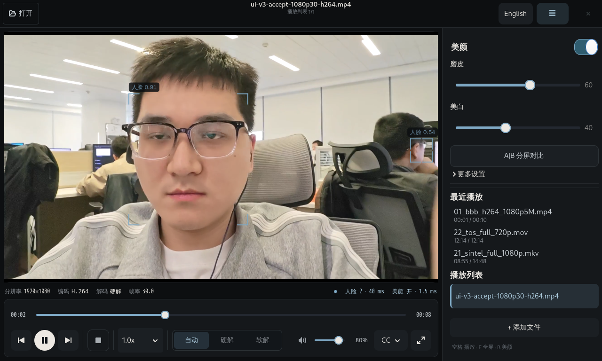
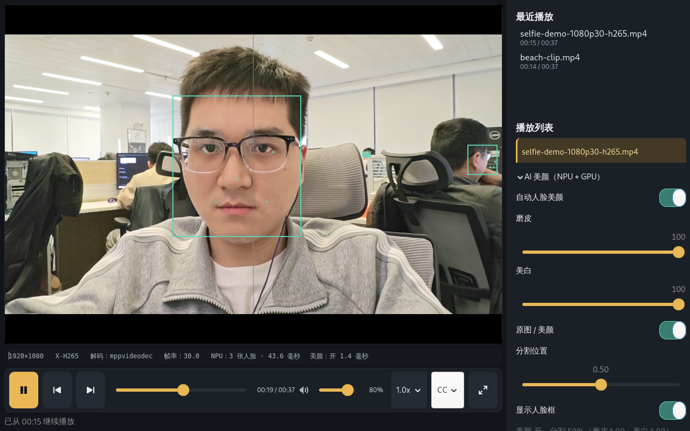

[English](README.md) | 简体中文

# Quectel Pi M2 视频播放器

面向 [Quectel Pi M2](https://developer.quectel.com/doc/sbc/en/index.html)（RK3576）的本地视频播放器。视频由 VPU 硬解、内嵌 GTK4 窗口渲染，播放器该有的东西都在：文件夹播放列表、最近播放、断点续播、外挂字幕、音轨切换、倍速/全屏/音量，以及如实报告解码路径与帧率的信息面板。

NPU 人脸检测与 GPU 磨皮美白是**这个播放器的一项能力**，不是它的主题：侧栏顶部一块一级「美颜」面板，关掉之后播放器本身分毫不变。两者默认关闭，点开视频立即播放；要展示效果时用 `--demo` 一次开启。桌面交互参考 [IINA](https://iina.io/)，分层设计（解码 → 滤镜 → 渲染）参考 [google/ExoPlayer](https://github.com/google/ExoPlayer)。

| | |
|---|---|
| 板卡 | Quectel Pi M2（RK3576），Debian 13，DSI 1280×800 |
| 播放 | 1080p30 H.264/H.265 硬解，稳定 30fps |
| 检测 | YuNet RKNN 跑在 NPU 上，10Hz，单次约 30–45ms |
| 美颜 | 单个 GPU shader pass，1080p 单帧约 0.9ms（分屏 + warp 约 2.4ms） |
| 测试 | 42 个文件、531 个用例 |



*板端实拍（2026-11-26 UI v3，1280x768）：信息行带「分辨率 / 编码 / 解码 / 帧率」标签，右侧是人脸/美颜实时组；编码归一为 `H.264`；控制条回到 44 px 两行；侧栏顶部是「美颜」一级面板；人脸框为四角 L 形 + 置信度标签。空态、全屏 dock、淡出后遥测、分屏标签见 [evidence](docs/evidence/README.md)。*

## 能做什么

分三组：播放器本身的功能、片库管理，以及这块板卡额外提供的能力。

**播放**

- **本地硬解播放** —— MP4 / M4V / MOV / MKV / WebM / TS / M2TS，H.264 与 H.265 经 `mppvideodec` 走 VPU；音频支持 AAC/MP3/Opus。其他编码在开发主机上回退到软解。控制条上的「自动 / 硬解 / 软解」三段可在三种策略间切换；自动档下硬解中途失败会自动改用软解。
- **播放控制** —— 播放/暂停、拖动进度、音量、0.5×–2.0× 倍速、全屏、上一首/下一首、返回列表；`A|B` 分屏对比开关收在侧栏「美颜」面板里，全屏时 dock 上另有「对比」pill。
- **空态即拖放区** —— 播放页在没有片时（无参数启动现在落在浏览壳的首页）仍是整块拖放区：没有片时不显示任何传输控制，视频区是一整块拖放区：主 CTA「选择文件」、次 CTA「选择文件夹」、拖放提示与能力 chip；文件/文件夹也可以直接拖进画面。
- **浏览壳（ui-v5 P1+P2）** —— 不带文件启动时进入浏览壳：88 px 左导航（首页 / 片库 / 最近 / 设置）、4×3 海报网格（时长 / 分辨率 / 编码由工作线程探测，海报在后台解码取帧并缓存）、全部 / 最近观看 / 已看完筛选、名称 / 时长 / 最近添加排序、重新扫描、选择目录，以及带扫描范围与格式栏的空态。文件和文件夹可以直接拖到任意浏览页：文件夹并入扫描目录，视频直接播放。`library.directories` 决定扫描目录，页内选择的目录写在 XDG state。P1–P3 均已部署到板端并完成验收。
- **首页（ui-v5 P3）** —— 落点页：主视觉是最近观看那一条（真实「继续观看 mm:ss」CTA、真实参数行、解码行、1140 px 大图），下面是「继续观看」4 张带进度与剩余时间的卡片和「最近添加」4 张卡片；数据全部来自扫描结果与播放历史。主视觉是弹性高度，1280×768 的板端窗口不会被撑大；片库为空时换成整页首启空态（选择目录 / 打开文件 / 前往片库），而不是空主视觉。
- **详情页（ui-v5 P3）** —— 点片库卡片或首页「最近添加」卡片进入：1140 px 背景板（chips / 标题 / 路径 / 续播·播放·重播 CTA）、3 列选集（同目录文件；当前条琥珀描边 + `正在播放` + 自动滚入）、7 行文件参数（编码 / 画面 / 帧率 / 时长 / 大小 / 码率 / 解码）和同目录 3 行。不造假数据：没有评分 / 演员 / 会员，视觉稿的简介位放真实文件路径；选集顺序同时就是播放列表，上一项/下一项/播完自动下一集都在这份列表里。
- **全屏沉浸** —— 进全屏收起侧栏，控制条变成不透明 dock 浮在画面上，带「美颜 / 对比」pill；静止 2.5 秒后 dock 淡出，但左上角单行遥测（分辨率/编码/解码/fps/人脸/美颜）和底边 2 px 进度线保留；动鼠标、按键或轻点画面唤回，暂停时保持常显。
- **外挂字幕** —— 同名 `.srt` 自动加载（含 `.zh.srt` / `.en.srt`），以 GTK 图层画在画面上方，不碰 30fps 视频链路；`CC` 按钮开关或另选文件；UTF-8 与 GB18030 都能解码。
- **音轨切换** —— `CC` 弹层列出容器内的音轨，通过 `qtdemux current-audio` + 重连 + seek 回当前位置切换；只连接选中的那条 pad，双音轨素材不会再两路混播。
- **信息行 / 遥测** —— 窗口态是带标签的 `分辨率 / 编码 / 解码 / 帧率` + 右侧 `● 人脸 / 美颜` 实时组；全屏态是左上角同数据的单行版本。编码由 caps 的 `X-H264/X-H265` 归一显示为 `H.264/H.265`，全部从运行中的管线读取。

**片库**

- **文件夹播放列表** —— 打开一个文件即载入其所在文件夹（按名称排序），用 `P` / `N` 或方向键前后切换。
- **断点续播** —— 按文件记录位置（XDG state，键为路径 + 大小 + mtime，重编码过的同名文件会从头播），preroll 之后恢复；开头 10 秒与结尾 15 秒不记录。`player.resume: false` 可关闭。
- **最近播放** —— 最多 20 条、最新在前，每条显示「看过/总长」，点一下回到该片。已在当前播放列表里的片子不再重复显示（全部重复时整个区块隐藏）；播完的片子仍留在历史里；文件被删掉的行自动隐藏但记录保留，移动硬盘插回来还会出现。`player.recent_files: false` 可关闭。
- **中英文界面** —— 标题栏即时切换全部文案（桌面图标名仍是「视频播放器」），选择保存到 `~/.config/video-player-demo/ui.json`，`--lang {zh,en}` 只覆盖本次启动。默认中文。

**板卡能力**

- **NPU 人脸检测** —— YuNet RKNN 模型在工作线程里每隔 N 帧跑一次（默认 10Hz），GTK 图层绘制四角 L 形人脸框 + 置信度小标签（关键点仍用于美颜 warp，但不再画 5 个圆点）；画面无人脸时不处理。默认关闭：检测器首次要花约 1.7 s 预热 NPU，只有按 `B`、开侧栏开关或用 `--demo` 时才启用。
- **检测保持** —— 某帧没检测到人脸时，沿用上一次的人脸框与关键点 `detection.hold_ms`（默认 600，钳位 0–5000），美颜跨过检测空档持续生效，不再时开时关（近景素材实测空档 6 → 0）。
- **自动美颜** —— 单个 `glshader` pass：保边双边近似磨皮 + 带饱和度回补的美白，只作用在按关键点拟合、羽化并经肤色门限保护的脸型椭圆内。肤色门限用两级 CIELAB 阈值——这是「头发发白、镜框被抹平」的修复点。
- **一键对比** —— 侧栏「美颜」面板的 `A|B` 按钮、全屏 dock 的「对比」pill，或 `C` 键切到同帧分屏（左原图、右美颜，分屏线两侧有「原图 / 美颜」标签与磨皮/美白参数行）；`B` 键开关美颜。美颜默认关闭，`--demo` 启动即分屏、展开美颜面板并显式开启美颜。
- **实验性瘦脸/大眼** —— 同一 shader 内的几何反向 warp，两项滑杆默认 0（视觉上与不加 warp 完全一致），拉满 100 时每帧约增加 0.1ms。



*板端演示模式的分屏（磨皮 100 / 美白 100，分割位置 0.50）：左半原图，右半是 GPU 在关键点拟合的脸型椭圆内做的磨皮 + 美白；默认 60 / 40 时效果更克制。*

## 怎么实现的

```
filesrc → qtdemux ─┬─ video ─ h26xparse → mppvideodec (VPU) → glupload → glcolorconvert
                   │          → glcolorscale (≤1280) → glshader (磨皮 + 美白 + 分屏 + warp)
                   │          → tee ─┬→ fpsdisplaysink → gtk4paintablesink
                   │                └→ glvideomixer → mpph264enc   (--record)
                   └─ audio ─ decodebin → audioconvert → volume → autoaudiosink

解码 src pad probe，每 3 帧取一帧 → 工作线程 → NV12→BGR → YuNet (NPU)
                                   → GLib.idle_add → shader uniforms
```

有三处看着不起眼、但决定了成败：

- **不引入第二张蒙版纹理。** 脸型椭圆、羽化与肤色门限全部在片元 shader 里用 uniform 浮点光栅化，绕开了 `glshader` 只能绑一个采样器的限制。
- **同帧分屏。** `u_compare` 在片元里切左右，不存在两路管线的帧对齐问题。
- **渲染前预缩放。** 纹理尺寸不足控件一半时 GSK 会退回 CPU 缩放，CPU 从 18% 飙到 62–78%；`glcolorscale` 就是为这个加的。改布局时请记得 `player.texture_max_dimension`。

完整管线与线程模型见 [docs/ARCHITECTURE.md](docs/ARCHITECTURE.md)，踩过的坑见 [docs/PITFALLS.md](docs/PITFALLS.md)。

## 安装

`./install.sh` 先校验运行环境，再为当前用户部署播放器：PATH 上的启动器与桌面入口。无需 `sudo`、不执行 `apt`——系统软件包随板端镜像提供。

```bash
git clone https://github.com/Trystwo/demo-video-player.git
cd demo-video-player
chmod 755 install.sh
./install.sh --require-board
```

`--require-board` 把板端专属项（`mppvideodec`、`mpph264enc`、`gtk4paintablesink`、`librknnrt`、`librga`）从警告提升为失败；`models/*.rknn` 缺失只警告，因为人脸检测是可选功能。加 `--no-desktop` 可跳过部署，`--bin-dir` / `--desktop-dir` 可覆盖 XDG 目录。

板端没有网络或 git 时用 `board-install.sh`：源码、图标和桌面图标扩展都内嵌在一个文件里，执行 `bash board-install.sh [目标目录]` 即可。内嵌的源码包是生成物——改动任何会随包发布的文件后要跑 `python3 scripts/build_board_install.py` 重新生成（发布前用 `--check` 校验），否则离线安装出来的还是旧界面。

环境要求：Debian 13 出厂镜像 + GNOME/Wayland 会话、Python 3.10+（板端 3.13）、GStreamer 1.x 及 Rockchip 插件、`gst-plugin-gtk4`（镜像自带 0.13.5）、PyGObject 与 GTK4 **走 apt 不走 pip**（typelib 必须与系统 GStreamer 匹配）、NumPy 2.2，以及板卡镜像自带的 RKNN/RGA 库。

运行前先自检：

```bash
PYTHONPATH=src python3 -m video_player --check     # 以 ok=/warn=/fail= 汇总行结束
python3 scripts/probe_board.py --markdown          # 板卡能力报告
python3 -m pytest tests -q                         # 531 个用例；依赖 NumPy/GI 的会自动跳过
```

## 运行

```bash
video-player-demo                                               # 进入首页（ui-v5 P3）
video-player-demo /path/to/video.mp4                            # 窗口模式
video-player-demo --demo /path/to/folder                        # 全屏演示模式
video-player-demo --lang en video.mp4                           # 本次用英文界面
video-player-demo --record /tmp/demo.mp4 --record-duration 10   # 录制窗口
```

在源码树里 `cd src && python3 -m video_player ...` 效果相同。其他参数：`--fullscreen`、`--config FILE`、`--snapshot FILE`、`--snapshot-delay S`、`--version`。

`--record` 在管线内用 `glvideomixer` 把 GPU 视频分支与 UI 覆盖层画布合成、再由 `mpph264enc` 编码，所以无需采集卡就能在板端录出带面板、人脸框与信息行的 30fps 窗口画面。录制期间屏幕上的视频区会变黑——GPU 分支交给编码器了，文件本身正常。

### 快捷键

| 按键 | 作用 | 按键 | 作用 |
|---|---|---|---|
| `Space` | 播放 / 暂停 | `S` | 停止并回到开头 |
| `←` `→` | 后退 / 前进 10 秒 | `B` | 美颜开 / 关 |
| `P` `N` | 上一首 / 下一首 | `C` | 对比 / 分屏 |
| `F` | 全屏沉浸（`Esc` 退出） | `M` | 遮罩预览 |
| `O` | 打开文件 | `R` | 开始 / 停止录制 |

## 配置

所有可调项都在一个 JSON 文件里：`configs/player.example.json`，或用 `--config` 指到别处。校验是严格的——未知键直接报错、超范围数值钳位、出错时指名是哪个键。

| 配置项 | 默认值 | 作用 |
|---|---|---|
| `player.decode_mode` | `auto` | 解码策略：`auto` 优先 VPU、失败退软解；`hw` / `sw` 强制硬解 / 软解 |
| `player.resume` | `true` | 按文件记住播放位置 |
| `player.recent_files` | `true` | 保留「最近播放」历史 |
| `player.texture_max_dimension` | `1280` | 进 GTK sink 前的预缩放上限（见上面的 CPU 说明） |
| `detection.enabled` | `false` | NPU 人脸检测默认关闭（点视频立即播放）；`--demo` / 美颜 / 人脸框按需开启；自定义 `--config` 里写 `true` 则始终开启 |
| `detection.hold_ms` | `600` | 无脸帧沿用上次人脸框的时长（0–5000） |
| `detection.max_faces` | `3` | 每帧跟踪的人脸数 |
| `beauty.enabled` | `false` | 美颜默认关闭（以播放为主）；按 `B` 或侧栏开关打开；`--demo` 演示模式显式开启 |
| `beauty.smoothing` / `beauty.whitening` | `60` / `40` | 磨皮 / 美白强度 0–100，拖动即时生效 |
| `beauty.face_slim` / `beauty.eye_enlarge` | `0` / `0` | 实验性瘦脸 / 大眼 0–100 |
| `library.directories` | `[]` | 片库页扫描的目录（单层）。空数组就是空态；页内选择的目录启动时从 XDG state 追加。`library.max_items` 限制单次扫描条数（默认 500） |

## 项目结构

```
demo-video-player/
├── configs/player.example.json   # 可调项的唯一真源
├── docs/                         # PRD、架构、板端清单、坑清单、证据图
├── models/                       # YuNet RKNN 权重（见 models/README.md，不入库）
├── scripts/                      # probe_board、perf_probe、模型转换、离线安装包生成
├── src/video_player/
│   ├── app.py                    # 命令行入口
│   ├── backend.py                # GStreamer 管线：构建、probe、seek、录制
│   ├── pipeline.py               # 按容器/编码选元素（纯函数，可单测）
│   ├── playlist.py               # 文件夹扫描
│   ├── browse.py                 # 首页/详情纯数据：hero、选集、参数卡、码率
│   ├── library.py                # 片库目录、扫描、元数据缓存、筛选
│   ├── probe.py                  # 元数据与海报帧探测（工作线程）
│   ├── resume.py                 # 断点续播存储
│   ├── recents.py                # 最近播放存储
│   ├── subtitle.py               # SRT 解析与候选查找
│   ├── beauty.py                 # GLSL shader 与 uniforms
│   ├── detection.py              # 抽帧、保持、关键点 EMA
│   ├── face.py / face_yunet.py   # 几何与模型封装
│   ├── rknn_runtime.py           # NPU 运行时绑定，无 NPU 时降级
│   ├── recording.py              # 应用内录制
│   ├── config.py / envcheck.py / i18n.py / diagnostics.py
│   └── ui/                       # GTK4 窗口、样式 token、浏览壳（rail/home/library/detail）、Cairo 海报、录制覆盖层
├── tests/                        # 531 个 pytest 用例
├── install.sh                    # 环境检查 + 用户级部署
└── board-install.sh              # 单文件离线安装器（内嵌源码包）
```

## 性能

板端 1080p30 实测：

| 场景 | 帧率 | CPU | 说明 |
|---|---|---|---|
| 仅播放 | 30 | 约 16% | M1 基线 |
| + 美颜（关检测） | 30 | 30–32% | shader 单帧 0.87ms |
| + 检测 + 美颜 | 30.0 | 117–131% | 主要开销是 10Hz 的 YuNet 推理 |
| + 实验 warp 拉满 100 | 30 | 每帧 +约 0.1ms | |
| demo 全开（分屏、全效果） | 30.8 | — | 美颜 2.4ms、NPU 45ms |

1 小时长跑已完成（3549 个 PERF 样本，见 [docs/BOARD.md](docs/BOARD.md)）。

## 当前状态

| 里程碑 | 范围 | 状态 |
|---|---|---|
| M0 | 项目骨架：配置契约、管线规划、环境自检、UI 外壳 | ✅ 2026-11-14 |
| M1 | GStreamer 硬解播放、GTK4 内嵌、控制、播放列表 | ✅ 2026-11-14（30fps，CPU 约 16%） |
| M2 | RKNN YuNet 人脸检测（10Hz）、GTK 人脸框/关键点、信息行 NPU 耗时 | ✅ 2026-11-16 |
| M3 | GPU 磨皮/美白、人脸遮罩与对比模式 | ✅ 2026-11-17（美颜约 1ms/帧） |
| M4 | 验收 A1–A5、板端证据、首版演示视频、部署脚本 | ✅ 2026-11-18 |
| M5 | 检测保持、实验性瘦脸/大眼、v3 演示视频 | ✅ 2026-11-19（v1.1.1；近景空档 6 → 0） |
| M6 | 播放器能力补全：真·断点续播、最近播放、外挂字幕、音轨切换、播放优先布局 | ✅ 2026-11-24（板端：续播 12.8s 恢复、最近播放跨重启保序、SRT 上屏、双音轨切换后 seek 回位、30.8fps / 美颜 2.4ms） |
| UI v5 | 浏览壳：琥珀 token 主题（P1）、左导航 + 片库网格 + 筛选/排序 + 空态 + 拖放（P2）、首页 + 详情页（P3） | ✅ 2026-11-27（v1.2.0）：P1/P2 于 2026-11-26 板端验收；P3 已部署并验收（首页 / 详情 / 续播 seek / EOS 自动下一集）；应用内录制画布已包含标题栏 |

网络流（HTTP/HLS/RTSP/RTMP，验收 A6）与内嵌字幕轨 / `.ass` 样式仍不在本期范围。

## 演示视频

52 秒 v3 演示（1080p30、中英双语硬字幕）由板端应用内录制模式生成，不需要采集卡：[飞书页面](https://quectel.feishu.cn/wiki/Y8fBwBgD8ieBZnknQjqcGotZnvb) · [GitHub Release 资产](https://github.com/Trystwo/demo-video-player/releases/download/v1.1.1/video-player-m5-demo-v3.mp4)。

## 限制

- 演示级实现，不是加固的分发版本：没有鉴权、沙箱与 DRM。
- 只播本地文件。后续恢复网络流时也不做远端内容校验，只连接可信来源。
- 检测目前仍在**流线程**里抽帧（每 3 帧 `extract_dup()` 一整帧 1080p NV12，17–33ms）。这正是 demo 全开时 CPU 超过一个核的原因；改到 RGA 缩帧是计划中的修法。
- 美颜按近景人像、最多三张脸（`detection.max_faces`）调参；4K 输入未实测，极差的素材仍可能出现超过 `detection.hold_ms` 的空档。
- **应用内录制成片带 `yuvj420p / pc / gbr` 标签**：RGBA（sRGB）画布直接喂 `mpph264enc`，画面本身正常，但严格按标签转换的播放器/转码链可能偏色。两版改成 `yuv420p / tv / bt709` 的实验让内容掉到 5.5–6.9 唯一帧/秒（CPU 版还丢 moov），已回退；见 [docs/PITFALLS.md](docs/PITFALLS.md) §3。
- **尚未在触摸屏上人工验证**：chip/卡片的点按、真实拖放、目录选择、排序弹层，以及浏览壳里的 H.265/VP9/AV1 文件；目前用合成事件与 H.264/H.265 验收片验证。
- **离线安装包不带 RKNN 模型**：`bash board-install.sh` 只解包源码，`models/*.rknn` 因许可与体积不内嵌，`--check` 会报 1 条 warn，需单独放入模型。
- 视频与图片素材不入库，RKNN 权重也不入库——转换与放置方法见 [docs/BOARD.md](docs/BOARD.md)；演示只允许使用公司自有或已授权素材。

## 文档

- [产品需求（PRD）](docs/PRD.md)：定位、P0/P1 功能、验收标准与里程碑。
- [架构说明](docs/ARCHITECTURE.md)：管线、零拷贝策略、线程模型与性能预算。
- [板端环境](docs/BOARD.md)：板卡基线、实测数据、模型与素材清单。
- [坑清单](docs/PITFALLS.md)：这个板子上真正花过时间的坑。
- [演示指南](docs/DEMO_GUIDE.md)：演示流程、讲解要点与降级预案。

## 相关项目

更多板卡 Demo 见 [Quectel-Pi](https://github.com/Quectel-Pi) 组织：

- [demo-personal-cloudhost](https://github.com/Quectel-Pi/demo-personal-cloudhost)：面向局域网的个人云主机。
- [demo-gesture-remote-control](https://github.com/Quectel-Pi/demo-gesture-remote-control)：基于手势识别的隔空视频控制。
- [demo-webrtc-call](https://github.com/Quectel-Pi/demo-webrtc-call)：板端与手机之间的双向视频通话。
- [demo-rknn-object-detect](https://github.com/Quectel-Pi/demo-rknn-object-detect)：实时目标检测与多目标跟踪。

## 问题反馈

本项目以 Apache License 2.0 发布，见 [LICENSE](LICENSE)。

使用中如遇问题，请在 [Quectel 官方论坛](https://forumschinese.quectel.com/c/quectel-pi/58) 提交技术咨询；欢迎提交 Issue 与 Pull Request 帮助改进。
